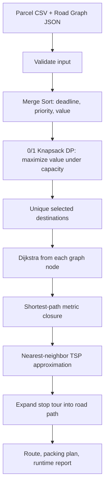

# Phase 1 — Courier Problem Design and Planning

## Problem statement
Given a batch of parcels, a finite-capacity delivery box, a depot, and a weighted road graph, choose a high-value feasible subset and produce an ordered route that visits every selected destination and returns to the depot.

## Data model
**Parcel:** `(parcel_id, destination, weight, priority, deadline, value)`.
- `weight` consumes box capacity.
- `deadline` is an integer deadline rank; smaller means earlier.
- `priority` is an urgency score; larger means more urgent.
- `value` is the reward score optimized by knapsack.

**Road graph:** weighted undirected graph `G=(V,E)`.
- Vertices are depot/customer locations.
- Each edge has a non-negative distance.
- JSON stores nodes, edges, and depot.

## Integrated pipeline

## Why these algorithms?
- Sorting provides a transparent urgency-first parcel view in `O(n log n)`.
- Dynamic programming solves the discrete 0/1 capacity selection problem optimally for the chosen value scores in `O(nW)`.
- Dijkstra is appropriate for non-negative road distances and gives exact shortest paths.
- TSP is computationally expensive; nearest-neighbor gives a fast approximate route for a prototype.

## Key limitation
The knapsack selection maximizes value, not deadline satisfaction. The sorted list is a prioritization aid. A production system should add deadline feasibility and time-window constraints to the optimization model.
